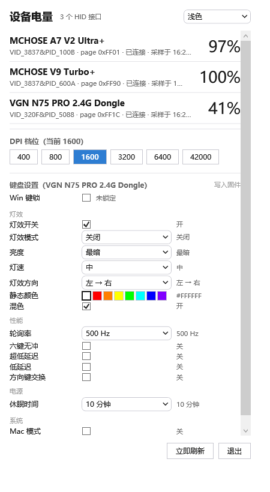
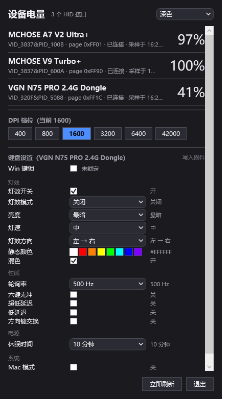
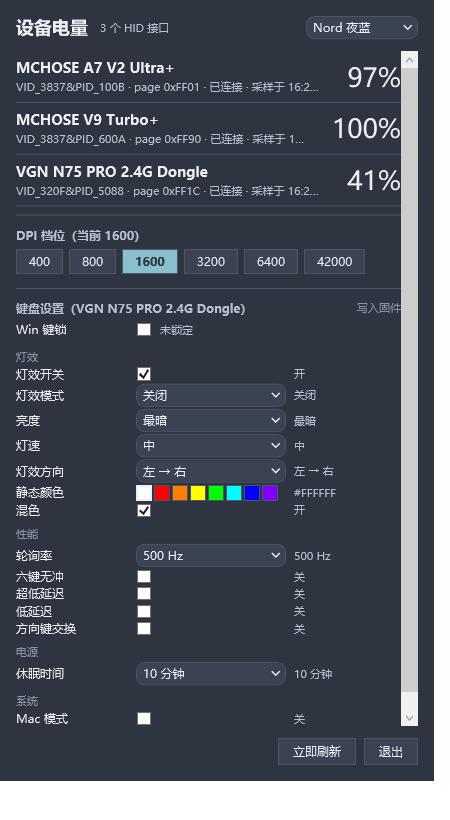

# GearTray

Windows 托盘工具：一眼看完所有 2.4G 无线外设的电量，并直接调它们的固件设置。

不用装厂商那一整套控制中心（MCHOSE HUB / VGN VHUB 各几百兆、常驻后台），
也不用把设备连到网页驱动上。开机常驻托盘，点一下就看。

皮肤只是 Token：内置浅色 / 深色，也支持 `skins/<id>/skin.json` 离线扩展（示例 `skins/nord`）。
切换时只替换资源字典，控件树一个都不动，所以不会闪、不会丢焦点。

| 浅色（内置） | 深色（内置） | Nord 夜蓝（磁盘 skin.json） |
|---|---|---|
|  |  |  |

## 能力

| 能力 | 说明 |
|---|---|
| 电量 | 托盘图标直接显示；支持充电状态、休眠态区分 |
| DPI | 六档读写，档位值可读回校验 |
| Win 键锁 | 写键盘**固件位**，不是挂全局键盘钩子模拟——退出程序依旧生效 |
| 灯效 | 模式 / 亮度 / 灯速 / 方向 / 静态色 / 混色 / 开关 |
| 性能 | 轮询率 / 六键无冲 / 超低延迟 / 低延迟 / 方向键交换 |
| 电源 | 休眠时间 |
| 系统 | Mac 模式 |

写固件的统一流程是「读整块 → 只改目标字节 → 整块写回 → 回读校验 → 不一致整块回滚」，
所以界面不会出现「点过了但没生效」的假象。

## 已支持设备

| 设备 | VID:PID | 状态 |
|---|---|---|
| MCHOSE A7 V2 Ultra+ | `3837:100B` | 电量 ✅ / DPI ✅ 实机验证 |
| MCHOSE V9 Turbo+（耳机） | `3837:600A` | 电量 ✅ |
| VGN N75 PRO | `320F:5088` | 电量 ✅ / Win 锁 ✅ / 灯效 ✅ 实机验证 / 12 项固件设置 |

其余 HID 设备会被通用驱动接管（只显示基础信息，不写任何东西）。

「回读一致」和「物理生效」是两件事，逐项确认状态见
[`docs/protocol/2026-10-29-vgn-keyboard-protocol.md`](docs/protocol/2026-10-29-vgn-keyboard-protocol.md) §4.6。

## 架构

```
src/Core.Abstractions   契约与 DTO（驱动只见接口，UI 只见快照）
src/Transports.Hid      Win32 HID 封装（cfgcmgr32 枚举、overlapped 读写、CancelIoEx）
src/Drivers.*           设备驱动：Generic / McHose / Vgn
src/Core.Application    设备仓库（按物理身份竞标、去重）、轮询调度
src/Host.Wpf            WPF 宿主：托盘（原生 TrackPopupMenuEx）+ 面板
src/Tools.HidProbe      命令行探测台（逆向协议时的主要工具）
```

几条硬约定：

- **UI 永远不直接持有设备会话**，只消费不可变快照。
- **驱动按分数竞标**：专用驱动 100 分压过通用驱动 10 分，注册顺序无关。
- **按物理身份分组**：一只鼠标会暴露 5 个 HID 接口，必须按 VID+PID+序列号聚成一台。
- 未验证型号**禁写**：同族 PID 未经验证的设备只读不写，避免写坏别人的灯效配置。

## 构建运行

需要 .NET 10 SDK（Windows）。

```bash
dotnet build GearTray.slnx

# 托盘常驻
src/Host.Wpf/bin/Debug/net10.0-windows/GearTray.exe

# 不开托盘，跑一次完整轮询打快照（验证「竞标 → 会话 → 电量 → 设置」整条链路）
src/Host.Wpf/bin/Debug/net10.0-windows/GearTray.exe --snapshot

# 走完整驱动链路写一项设置
src/Host.Wpf/bin/Debug/net10.0-windows/GearTray.exe --set light.brightness=3
```

## 调试与逆向工具

```bash
cd src/Tools.HidProbe/bin/Debug/net10.0-windows

hidprobe --json                              # 全部 HID 接口拓扑
hidprobe --pid 5088 --caps                   # 能力报告
hidprobe --pid 5088 --writable               # 哪些接口真能写（0x0001/0x000C 集合拒写）
hidprobe --pid 100B --mchose-battery         # MCHOSE 电量
hidprobe --pid 5088 --vgn-ws-settings        # VGN 14 项设置全解码
hidprobe --pid 5088 --vgn-ws-set light.brightness=3   # 写一项 + 回读 + 打印连带改动
```

`tools/asarx/asar.mjs` 是一个零依赖的 asar 读取器（`ls` / `grep` / `cat` / `x`），
用来从 Electron 客户端里取渲染层 JS——逆向厂商客户端时比装 `asar` 包快。

## 文档

- [`docs/DESIGN.md`](docs/DESIGN.md) —— 15 章架构设计
- [`docs/protocol/`](docs/protocol/) —— 逐台设备的协议记录与踩坑

## 路线图

- [x] 皮肤系统 S0：语义 Token + 内置浅色/深色 + `skins/` 离线加载（热切换不重建控件）
- [ ] 皮肤系统 S1：`CardList` / `Showcase` / `Console` / `Sidebar` 四套布局模板
- [ ] 描述符引擎：用 JSON 描述设备，不必为每台设备写一个 C# 驱动
- [ ] 插件宿主：`plugins/` 目录离线加载
- [ ] VGN 改键（ReadKey / ChangeKeys / Fn 层）

## 免责声明

协议全部来自对**本机已购买设备**的通信抓取与官方客户端的行为观察，仅用于让自有设备正常工作。
项目不包含任何厂商代码或二进制。命令字与偏移按实测记录，可能随固件版本变化。

与 MCHOSE、VGN 等厂商无任何关联。
